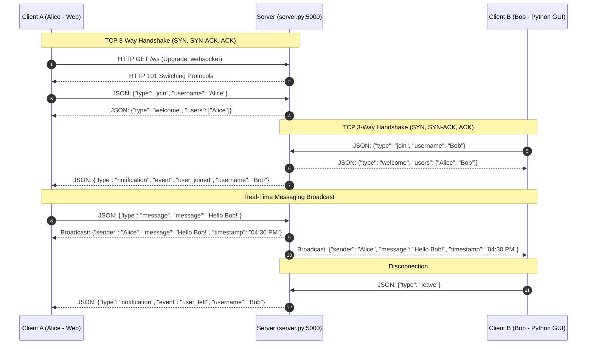

# NetVibe - LAN-Based Real-Time Chat Application

**Computer Networks Laboratory (CA-4 Mini Project)**  
*Demonstrating Socket Programming, TCP/IP Protocol, Multithreading, and Local Area Network Communication.*

---

## 📌 Project Overview

**NetVibe** is a full-featured, beginner-friendly LAN real-time messaging application designed to demonstrate fundamental computer networking concepts using Python 3 socket programming and modern web technologies. 

It allows multiple computers or mobile devices connected to the same Wi-Fi or Local Area Network (LAN) to communicate in real time through a central multithreaded TCP socket server.

### Key Highlights
- **Zero Third-Party Dependencies**: Runs directly on standard Python 3 (`socket`, `threading`, `json`, `struct`, `hashlib`, `base64`, `tkinter`). No external `pip install` required.
- **Dual-Protocol Unified Server**: Listens on TCP port 5000 and seamlessly serves both **Web Browser Clients** (via HTTP + WebSocket RFC 6455) and **Native Python Clients** (Desktop Tkinter GUI & Command-Line Interface).
- **Cross-Platform LAN Access**: Any laptop, desktop, Android phone, or iPhone connected to the same Wi-Fi can join instantly simply by opening the server's local IPv4 address in their web browser (e.g., `http://192.168.1.15:5000`).
- **Modern Messaging UI**: Features a sleek dark theme with message bubbles, dynamic color-coded avatar initials, online users panel, timestamps, connection status indicators, sound effects, and quick reaction chips.

---

## 📂 Project Folder Structure

```
NetVibe/
├── server.py              # Central Multithreaded TCP Socket Server (HTTP + WebSocket + Raw TCP)
├── client_gui.py          # Native Python Desktop GUI Client (built with Tkinter)
├── client.py              # Interactive Command-Line / Terminal TCP Client
├── test_lan_chat.py       # Automated 6-step verification test suite
├── static/
│   ├── index.html         # Modern, responsive Web Chat interface (HTML5)
│   ├── style.css          # Glassmorphic dark styling & responsive layout (CSS3)
│   └── script.js          # Real-time WebSocket communication & event handling (Vanilla JS)
├── README.md              # Installation, network setup, and execution guide
├── REPORT.md              # Comprehensive academic lab project report
└── VIVA_QUESTIONS.md      # 35+ Computer Networks Viva questions with in-depth answers
```

---

## 🌐 Network Architecture Diagram

```
                 +-----------------------------------------+
                 |       Wi-Fi Router / LAN Gateway        |
                 |             (192.168.1.1)               |
                 +--------------------+--------------------+
                                      |
         +----------------------------+----------------------------+
         |                                                         |
         v                                                         v
+-----------------------+                                 +-----------------------+
|    Server Computer    |                                 |   Client Device B     |
|   (Host: 192.168.1.15)|                                 |    (192.168.1.22)     |
|                       |                                 |                       |
|   +---------------+   |    TCP Connection (Port 5000)   |   Web Browser / GUI   |
|   |   server.py   |<======================================> |   (Alice)             |
|   |  Port: 5000   |   |                                 +-----------------------+
|   | (TCP / STREAM)|   |                                              |
|   +---------------+   |                                              |
|           ^           |    TCP Connection (Port 5000)                |
+-----------|-----------+ <============================================+
            |                                                          |
            v                                                          v
+-----------------------+                                 +-----------------------+
|    Client Device A    |                                 |   Client Device C     |
|    (Localhost/Host)   |                                 |    (192.168.1.35)     |
|   Web / Tkinter GUI   |                                 |   Mobile / Terminal   |
|   (Bob)               |                                 |   (Charlie)           |
+-----------------------+                                 +-----------------------+
```

### Client-Server Message Flow (Mermaid Sequence)



---

## 🚀 Execution & Setup Instructions

### Prerequisites
- **Python 3.8+** installed on the host machine. (Tested on Python 3.12).
- All devices must be connected to the **same Wi-Fi router** or mobile hotspot.

---

### Step 1: Start the Central Server

Open a terminal or PowerShell on the host computer:

```bash
cd c:\Users\GOKUL\Downloads\NetVibe
python server.py
```

The server will display:
```
=================================================================
        🚀 NetVibe - LAN Real-Time Chat Server 🚀
=================================================================
[*] Server Status        : ONLINE
[*] Transport Protocol   : TCP / IP (SOCK_STREAM)
[*] Bound Host           : 0.0.0.0 (All Interfaces)
[*] Local IPv4 Address   : 192.168.1.15
[*] TCP Port             : 5000
-----------------------------------------------------------------
[+] Web Browser Access   : http://192.168.1.15:5000
[+] Localhost Access     : http://127.0.0.1:5000
[+] Python GUI Client    : python client_gui.py
[+] Python CLI Client    : python client.py
-----------------------------------------------------------------
[*] Waiting for incoming client connections (Press Ctrl+C to stop)...
=================================================================
```
> **Note down the Local IPv4 Address** printed by the server (e.g., `192.168.1.15`). Clients will use this address to connect.

---

### Step 2: Connect Clients

You can connect multiple clients using any combination of the three available interfaces:

#### Option A: Web Browser Client (Recommended for LAN & Mobile)
1. Open Google Chrome, Firefox, Microsoft Edge, or Safari on **any computer or smartphone** connected to the same Wi-Fi.
2. In the address bar, enter:
   ```
   http://<SERVER_LOCAL_IP>:5000
   ```
   *(e.g., `http://192.168.1.15:5000` or `http://localhost:5000` on the host machine).*
3. Enter your **Username** and click **Connect & Join Room**.
4. You are now in the chat! Open another browser tab or another laptop to test multi-user chat.

#### Option B: Desktop GUI Client (Tkinter)
Run this command in a new terminal window:
```bash
python client_gui.py
```
1. Enter your **Username**, the **Server IPv4**, and **Port 5000**.
2. Click **Connect to LAN Server**.
3. A dark-themed desktop messaging window appears with online users and live messaging.

#### Option C: Terminal / Command-Line Client
Run this command in a new terminal window:
```bash
python client.py
```
1. Enter the Server IPv4 address and your username.
2. Type messages directly into the terminal and press Enter.

---

### Step 3: Run the Automated Test Suite

To verify socket connectivity, multithreading, and protocol handling without opening manual browsers:

```bash
python test_lan_chat.py
```

This tests 3 concurrent clients (Raw TCP + WebSocket) exchanging messages and verifying join/leave notifications.

---

## 🛡️ LAN Troubleshooting & Windows Firewall Notes

If client devices on the same Wi-Fi cannot open `http://<SERVER_IP>:5000`:

1. **Verify Same Network**: Ensure both the server computer and client phone/laptop are connected to the exact same Wi-Fi network (not one on cellular 5G and one on Wi-Fi).
2. **Allow Python in Windows Firewall**:
   - When running `server.py` for the first time, Windows may prompt: *"Windows Defender Firewall has blocked some features of this app"*. Check **Private Networks** and click **Allow Access**.
   - Alternatively, temporarily allow TCP port 5000 in PowerShell (as Administrator):
     ```powershell
     New-NetFirewallRule -DisplayName "NetVibe LAN Chat" -Direction Inbound -LocalPort 5000 -Protocol TCP -Action Allow
     ```
3. **Wi-Fi AP Isolation**: Some university or public Wi-Fi networks enable "Client Isolation" / "AP Isolation", preventing peer devices from talking to each other. If this occurs, create a **Mobile Hotspot** from a phone or laptop and connect all devices to it.

---

## 📡 Core Networking Concepts Demonstrated

| Concept | Implementation in NetVibe |
| :--- | :--- |
| **Local Area Network (LAN)** | Client-server communication bounded by local subnet (e.g. `192.168.x.x / 24`). |
| **Client-Server Architecture** | Centralized server manages state, user registry, and message distribution to clients. |
| **TCP / IP Protocol** | Uses `SOCK_STREAM` (Transmission Control Protocol) for reliable, ordered, error-checked byte delivery. |
| **Socket Programming** | Core Berkeley Socket API functions: `socket()`, `bind()`, `listen()`, `accept()`, `recv()`, `sendall()`, `close()`. |
| **IP Addresses & Ports** | Host binding on `0.0.0.0` (all adapters), transport endpoint addressing via TCP Port `5000`. |
| **Multithreading** | Dedicated worker thread (`threading.Thread`) spawned per client connection to handle concurrent I/O. |
| **Data Framing & Serialization** | JSON packet encoding/decoding, newline-delimited stream parsing, and RFC 6455 WebSocket framing. |
