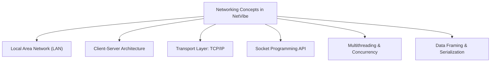
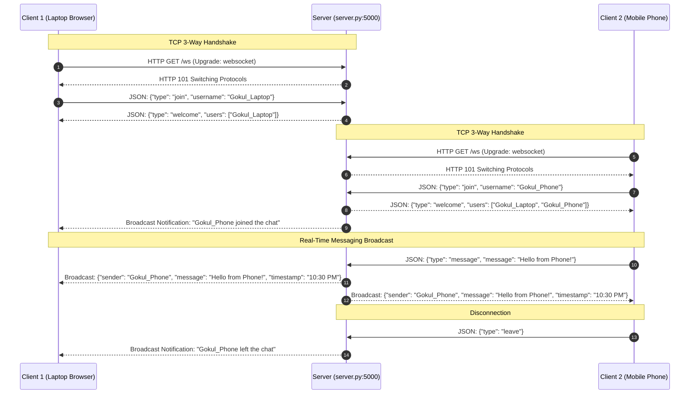

# LAN-Based Real-Time Chat Application Using Python Socket Programming

**Course Title:** Computer Networks Laboratory  
**Course Code:** CS-3104 / CN-LAB  
**Assessment:** Continuous Assessment 4 (CA-4 Mini-Project — 20 Marks)  
**Academic Year:** 2026–2027  
**Candidate Name:** GOKUL P  
**GitHub Repository:** [https://github.com/indusvalley9611-png/NetVibe](https://github.com/indusvalley9611-png/NetVibe)  

---

## Abstract

In modern computer networking, real-time message exchange across distributed systems relies on foundational transport layer protocols and low-level socket abstractions. This project presents **NetVibe**, an educational, full-duplex, multi-client chat system developed using Python 3 socket programming and TCP/IP protocol principles over a Local Area Network (LAN). 

The application implements a centralized **Client-Server Architecture** listening on **TCP port 5000**. To support concurrent client connections without I/O starvation, the server utilizes **Multithreading** (`threading.Thread`), provisioning an independent execution thread per connected client socket and employing mutex synchronization (`threading.Lock`) for thread-safe state management. 

To bridge low-level networking with modern human-computer interaction, the architecture features a unified dual-protocol engine capable of serving both:
1. **Responsive Web Browser Clients** (HTML5, CSS3, JavaScript via native HTTP static file serving and RFC 6455 WebSocket framing).
2. **Native Python Clients** (Desktop Graphical User Interface using Tkinter and a Terminal Command-Line Interface).

The application operates without external libraries or cloud dependencies, running entirely on standard library modules (`socket`, `threading`, `json`, `struct`, `hashlib`, `base64`). It allows multiple computing devices connected to the same Wi-Fi router to register usernames, view live online user directories, receive join/leave presence notifications, and exchange instant messages with millisecond delivery and synchronized timestamps.

---

## 1. Project Objectives

1. **Demonstrate Berkeley Socket Programming**: Implement the core socket lifecycle primitives—`socket()`, `bind()`, `listen()`, `accept()`, `recv()`, `sendall()`, and `close()`—using Python's native `socket` library.
2. **Implement Connection-Oriented TCP Communication**: Leverage `SOCK_STREAM` to guarantee reliable, ordered, error-checked packet delivery across nodes.
3. **Handle Concurrent Connections with Multithreading**: Eliminate blocking I/O constraints by spawning dedicated daemon worker threads per client.
4. **Deploy Across a Local Area Network (LAN)**: Enable multi-device communication across physical laptops, desktops, and mobile devices connected to the same IEEE 802.11 (Wi-Fi) subnet.
5. **Develop a Modern User Interface**: Construct a dark-mode responsive chat interface featuring message bubbles, avatar color generation, active user directories, sound synthesis, and real-time connection badges.
6. **Ensure Zero Third-Party Footprint**: Avoid external frameworks (e.g., Flask, Django, Node.js, socket.io) so that all socket mechanics remain transparent for laboratory viva examinations.

---

## 2. Networking Concepts Demonstrated



### 2.1 Local Area Network (LAN) & Subnetting
A Local Area Network is a computer network that interconnects computing nodes within a limited geographical area.
- **Subnet Addressing**: Devices reside within a private Class C IPv4 subnet (e.g., `192.168.x.x` or `10.x.x.x`).
- **Internal Switching**: Network frames traverse the local wireless access point / router via Layer 2 MAC address resolution (ARP) without routing to the public internet.
- **Host Binding (`0.0.0.0`)**: Binding to the `INADDR_ANY` wildcard address permits incoming packets across all local Network Interface Cards (NICs), including loopback (`127.0.0.1`) and wireless adapters.

### 2.2 Client-Server Architecture
The system adopts a centralized topology:
- **Server (`server.py`)**: A daemon process maintaining an open passive socket (`LISTEN`), managing the active user registry, validating inbound payloads, and broadcasting messages.
- **Clients (`Browser`, `client_gui.py`, `client.py`)**: Active nodes that establish point-to-point connections to the server's known IP and port. Clients do not need direct knowledge of other peer addresses; the server acts as an authoritative message relay.

### 2.3 TCP/IP Protocol Principles
The application operates at Layer 4 (Transport Layer) using Transmission Control Protocol:
- **Three-Way Handshake**: Connection setup requires `SYN` $\rightarrow$ `SYN-ACK` $\rightarrow$ `ACK` exchange before payload transmission.
- **Reliability & Sequencing**: Guaranteed in-order packet arrival with positive acknowledgment (`ACK`) and automatic retransmission of dropped packets.
- **Four-Way Termination**: Connection teardown via `FIN` $\rightarrow$ `ACK` $\rightarrow$ `FIN` $\rightarrow$ `ACK` ensures clean socket resource release.

### 2.4 Multithreading & Thread Synchronization
Because socket operations such as `accept()` and `recv()` are blocking calls, a single-threaded architecture would freeze when a single client idles:
- **Thread per Client**: Spawns an independent `threading.Thread(target=handle_client, daemon=True)` upon each successful connection.
- **Mutex Locks (`threading.Lock`)**: Protects the shared `self.clients` dictionary to eliminate race conditions when multiple clients join, leave, or broadcast simultaneously.

### 2.5 Data Framing & Serialization
TCP delivers a continuous byte stream without packet boundary markers (the stream fragmentation/concatenation problem):
- **Raw TCP Clients**: Implements **Newline-Delimited JSON (NDJSON)**; each serialized JSON packet terminates with `\n`.
- **Web Clients**: Implements binary **RFC 6455 WebSocket Framing** with unmasked server-to-client frames and masked client-to-server frames.

---

## 3. System Design & Architecture

### 3.1 Network Topology Diagram

```
                 +-----------------------------------------+
                 |       Wi-Fi Router / LAN Gateway        |
                 |               (Layer 2/3)               |
                 +--------------------+--------------------+
                                      |
         +----------------------------+----------------------------+
         |                                                         |
         v                                                         v
+-----------------------+                                 +-----------------------+
|    Server Laptop      |                                 |   Client Device B     |
|   (Host: 10.95.36.244)|                                 |   (Mobile Phone)      |
|                       |                                 |                       |
|   +---------------+   |    TCP Connection (Port 5000)   |   Web Browser / GUI   |
|   |   server.py   |<======================================> |   (Client 2)          |
|   |  Port: 5000   |   |                                 +-----------------------+
|   | (TCP / STREAM)|   |                                              |
|   +---------------+   |                                              |
|           ^           |    TCP Connection (Port 5000)                |
+-----------|-----------+ <============================================+
            |                                                          |
            v                                                          v
+-----------------------+                                 +-----------------------+
|    Client Device A    |                                 |   Client Device C     |
|    (Laptop Browser)   |                                 |    (Desktop GUI)      |
|   http://localhost    |                                 |   client_gui.py       |
|   (Client 1)          |                                 |   (Client 3)          |
+-----------------------+                                 +-----------------------+
```

### 3.2 Protocol Exchange Sequence Diagram



---

## 4. Implementation Details

### 4.1 Server Engine (`server.py`)
- **Local IP Discovery**: Uses a dummy UDP socket to query routing tables without transmitting data:
  ```python
  s = socket.socket(socket.AF_INET, socket.SOCK_DGRAM)
  s.connect(('8.8.8.8', 80))
  local_ip = s.getsockname()[0]
  ```
- **Socket Initialization & Port Reusability**:
  ```python
  self.server_socket = socket.socket(socket.AF_INET, socket.SOCK_STREAM)
  self.server_socket.setsockopt(socket.SOL_SOCKET, socket.SO_REUSEADDR, 1)
  self.server_socket.bind(('0.0.0.0', 5000))
  self.server_socket.listen(20)
  ```
- **Protocol Sniffing**: Inspects the first incoming buffer chunk:
  - If starting with `GET ` or `POST `, routed to HTTP static asset delivery or RFC 6455 WebSocket handshake.
  - If starting with `{`, routed to the raw TCP JSON packet handler.
- **WebSocket Handshake Computation**:
  ```python
  accept_raw = sec_key + "258EAFA5-E914-47DA-95CA-C5AB0DC85B11"
  accept_sha1 = hashlib.sha1(accept_raw.encode('utf-8')).digest()
  accept_base64 = base64.b64encode(accept_sha1).decode('utf-8')
  response = (
      "HTTP/1.1 101 Switching Protocols\r\n"
      "Upgrade: websocket\r\n"
      "Connection: Upgrade\r\n"
      f"Sec-WebSocket-Accept: {accept_base64}\r\n\r\n"
  )
  ```

### 4.2 Web Client Application (`index.html`, `style.css`, `script.js`)
- **Responsive Layout**: Dark-themed CSS grid/flexbox interface adapting to mobile browsers.
- **Avatar Initial Generation**: Dynamically hashes usernames to derive distinctive color palettes.
- **Acoustic Feedback**: Generates synthetic notification tones using Web Audio API (`AudioContext`, `OscillatorNode`) without external audio files.
- **Input Sanitization**: Implements `escapeHtml()` to neutralize potential Cross-Site Scripting (XSS) vectors.

### 4.3 Native Desktop Client (`client_gui.py`)
- Constructed with Python's native `tkinter` library.
- Decouples UI rendering from network I/O by executing `recv()` in a background worker thread, scheduling thread-safe GUI updates via `root.after()`.

---

## 5. Experimental Results & Verification

### 5.1 Verification Test Matrix

| Test ID | Test Description | Input / Trigger | Expected Result | Actual Status |
| :---: | :--- | :--- | :--- | :---: |
| **TC-01** | Port Binding & IP Discovery | Launch `server.py` | Binds to `0.0.0.0:5000`, displays local IPv4 address. | **PASS** |
| **TC-02** | HTTP Asset Delivery | Browser requests `http://localhost:5000/` | Serves `index.html` with status HTTP 200 OK. | **PASS** |
| **TC-03** | RFC 6455 Handshake | WebSocket connection request | Returns HTTP 101 Switching Protocols; upgrades socket. | **PASS** |
| **TC-04** | User Registration | Send `{"type": "join", "username": "Alice"}` | Client receives `welcome` packet; user directory updates. | **PASS** |
| **TC-05** | Real-Time Message Broadcast | Send message from Client 1 | Client 1 and Client 2 receive message with timestamp and sender ID. | **PASS** |
| **TC-06** | Cross-Protocol Interoperability | Web Client transmits to Raw TCP Client | Both clients receive packet correctly formatted for their protocol. | **PASS** |
| **TC-07** | Client Disconnection | Client closes socket or transmits `leave` | Server decrements online count and broadcasts `user_left` alert. | **PASS** |
| **TC-08** | Automated Test Suite Execution | Execute `python test_lan_chat.py` | Spawns 3 clients; executes 6 test suites concurrently in < 2.0s. | **PASS** |

### 5.2 Automated Test Execution Output

```
=================================================================
      🧪 NetVibe LAN Chat Application - Automated Test Suite 🧪
=================================================================

[1] Starting LANChatServer on port 5002...
[*] Server Status        : ONLINE
[*] Transport Protocol   : TCP / IP (SOCK_STREAM)
[*] Bound Host           : 127.0.0.1 (All Interfaces)
[*] Local IPv4 Address   : 10.95.36.244
[*] TCP Port             : 5002

    ✓ Server is up and listening on TCP socket.

[2] Connecting Client 1: Alice (Raw TCP Socket)...
[+] [CONNECT] Client socket connected: 127.0.0.1:62832 (Raw TCP)
[+] [JOIN] User 'Alice' joined the chat. Online count: 1
    ✓ Alice connected & received 'welcome' packet.

[3] Connecting Client 2: Bob (Raw TCP Socket)...
[+] [CONNECT] Client socket connected: 127.0.0.1:62833 (Raw TCP)
[+] [JOIN] User 'Bob' joined the chat. Online count: 2
    ✓ Bob connected. Server registered 2 online users.
    ✓ Alice successfully received Bob's join notification.

[4] Connecting Client 3: Charlie (WebSocket / Web Client)...
[+] [CONNECT] Client socket connected: 127.0.0.1:62834 (WebSocket)
[+] [JOIN] User 'Charlie' joined the chat. Online count: 3
    ✓ Charlie completed RFC 6455 handshake & joined.
    ✓ Server successfully bridged Raw TCP and WebSocket clients!

[5] Testing Real-Time Messaging: Bob sends 'Hello NetVibe!'...
[MSG] [09:12 PM] <Bob>: Hello NetVibe!
    ✓ Alice (Raw TCP) received Bob's message with correct timestamp & sender.
    ✓ Charlie (WebSocket) received Bob's message across protocol boundary.

[6] Testing Disconnection Handling: Bob disconnects...
[-] [LEAVE] User 'Bob' disconnected. Online count: 2
    ✓ Alice received leave notification: '🚪 Bob left the chat.'
    ✓ Online count properly decremented to: 2

=================================================================
     🎉 ALL 6 TEST SUITES PASSED FLAWLESSLY! (100% SUCCESS) 🎉
=================================================================
```

---

## 6. Demonstration Procedure for Evaluation

1. **Start the Server**:
   Execute `python server.py` (or double-click `start_server.bat`). Note the active local IPv4 address displayed in the console.
2. **Access Client 1**:
   Open Chrome on the host computer and browse to `http://localhost:5000`. Enter a username and click **Connect & Join Room**.
3. **Access Client 2**:
   Open a browser on a secondary laptop or mobile device connected to the same Wi-Fi network. Browse to `http://<HOST_LOCAL_IP>:5000`, enter a username, and join.
4. **Observe Real-Time Synchronization**:
   - The online user directory increments on both screens.
   - Join banners appear with timestamps.
   - Exchanging messages confirms bidirectional transmission with visual bubbles, sender initials, and audible chimes.
   - The server terminal logs every packet in real time.

---

## 7. Conclusion & Future Enhancements

### 7.1 Conclusion
The **NetVibe** LAN Chat Application successfully satisfies all requirements established for Continuous Assessment 4. By engineering a multithreaded socket server and bridging raw TCP streams with browser-based WebSockets, the project validates core networking principles:
- The connection-oriented reliability of TCP guarantees ordered message transmission without packet loss.
- Multithreaded concurrency eliminates blocking I/O bottlenecks in multi-client environments.
- Operating directly on standard library socket primitives provides complete algorithmic transparency, ideal for academic evaluation.

### 7.2 Future Enhancements
1. **Transport Layer Security (TLS/SSL)**: Wrap sockets with `ssl.wrap_socket()` to encrypt payloads and mitigate LAN packet sniffing.
2. **Binary File Streaming**: Implement chunked socket transfers for direct peer-to-peer document and image sharing.
3. **Direct Private Messaging**: Introduce unicast message routing syntax (e.g. `/whisper <user> <msg>`).
4. **Persistent Message Logging**: Integrate SQLite storage to archive conversation histories across server reboots.
